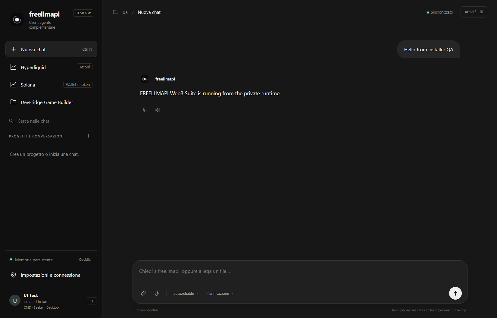

# FREELLMAPI Web3 Suite

Independent CMD, Qt desktop and Android companion clients with Hyperliquid, Solana, Helius and Pump.fun integrations.

Also supports [DevFridge Game Builder](https://github.com/mikeminer/devfridge/tree/master/skills/devfridge-game-builder)
for Three.js browser games, Seeker APKs and optional Solana wallet/subscription
integration. Install the full skill package with its references and assets as
described in the English guide; the desktop entry point is already included.

[English user guide](packaging/windows/USER_GUIDE.md) · [Build and verification](packaging/windows/README.md)

Uses the unmodified official FreeLLMAPI router. This fork is a complementary Web3 distribution, not an upstream endorsement.

The screenshot uses a synthetic UI fixture from the installed private runtime;
it does not depict a live model response or trading operation.

[Installer acceptance report](BUILD_REPORT.md) · [Structured results](results.json)
